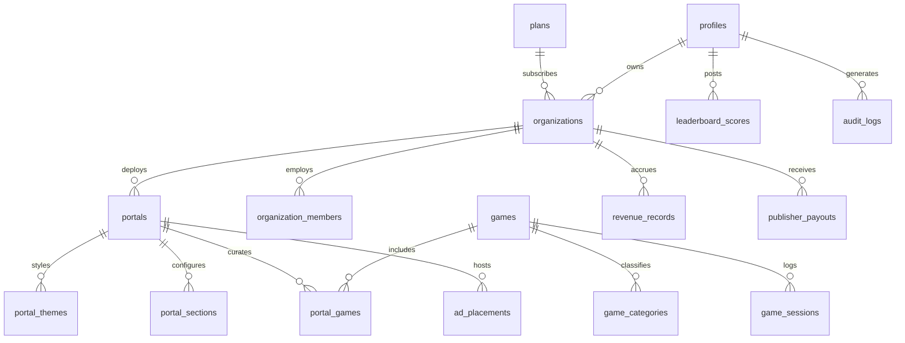

# DATABASE SCHEMA & MIGRATION SPECIFICATION

## 1. Relational Entity Overview
The database is built on PostgreSQL with Supabase, leveraging Row Level Security (RLS) policies for multi-tenant isolation.



## 2. Table Definitions

### `plans`
Subscription tiers governing publisher portal quotas and feature access.
- `id` (UUID, Primary Key)
- `name` (TEXT, e.g. Free, Starter, Pro, Enterprise)
- `slug` (TEXT UNIQUE)
- `price_monthly` (NUMERIC)
- `price_yearly` (NUMERIC)
- `max_portals` (INT)
- `max_team_members` (INT)
- `max_games_per_portal` (INT)
- `features` (JSONB)

### `profiles`
User accounts extending Supabase `auth.users`.
- `id` (UUID, Primary Key, Foreign Key to `auth.users.id`)
- `username` (TEXT UNIQUE)
- `display_name` (TEXT)
- `avatar_url` (TEXT)
- `system_role` (TEXT, 'super_admin' | 'publisher' | 'player')
- `is_banned` (BOOLEAN)
- `created_at` (TIMESTAMPTZ)

### `organizations`
Publisher commercial entities.
- `id` (UUID, Primary Key)
- `name` (TEXT)
- `slug` (TEXT UNIQUE)
- `owner_id` (UUID, Foreign Key to `profiles.id`)
- `plan_id` (UUID, Foreign Key to `plans.id`)
- `status` (TEXT, 'pending' | 'active' | 'suspended' | 'rejected')

### `portals`
White-label gaming portal deployments.
- `id` (UUID, Primary Key)
- `organization_id` (UUID, Foreign Key to `organizations.id`)
- `name` (TEXT)
- `slug` (TEXT UNIQUE)
- `tagline` (TEXT)
- `status` (TEXT, 'draft' | 'published' | 'paused' | 'archived')
- `custom_domain` (TEXT UNIQUE)
- `domain_verified` (BOOLEAN)
- `seo_title`, `seo_description`, `seo_keywords`

### `games`
Global catalog of verified HTML5 games.
- `id` (UUID, Primary Key)
- `title` (TEXT)
- `slug` (TEXT UNIQUE)
- `category_id` (UUID, Foreign Key to `game_categories.id`)
- `game_url` (TEXT)
- `game_type` (TEXT, 'iframe' | 'storage' | 'sdk')
- `technology` (TEXT, 'html5' | 'phaser' | 'unity_webgl' | 'other')
- `orientation` (TEXT, 'portrait' | 'landscape' | 'both')
- `approval_status` (TEXT, 'pending' | 'approved' | 'rejected')
- `play_count` (BIGINT)
- `rating_average` (NUMERIC)
- `iframe_sandbox_allow` (TEXT)

### `ad_placements`
Monetization slot configurations per portal.
- `id` (UUID, Primary Key)
- `portal_id` (UUID, Foreign Key to `portals.id`)
- `organization_id` (UUID, Foreign Key to `organizations.id`)
- `placement_key` (TEXT)
- `ad_format` (TEXT, 'banner' | 'responsive' | 'interstitial' | 'rewarded_video')
- `is_enabled` (BOOLEAN)
- `frequency_cap` (INT)

### `revenue_records`
Audited line-item earnings.
- `id` (UUID, Primary Key)
- `organization_id` (UUID, Foreign Key to `organizations.id`)
- `gross_amount` (NUMERIC)
- `platform_share` (NUMERIC)
- `publisher_share` (NUMERIC)
- `status` (TEXT, 'estimated' | 'verified' | 'paid' | 'voided')

## 3. Row Level Security (RLS) Policies
- **Tenant Isolation:** Every query on `portals`, `ad_placements`, and `revenue_records` enforces:
  ```sql
  WHERE organization_id IN (
    SELECT organization_id FROM organization_members WHERE user_id = auth.uid()
  )
  ```
- **Public Visibility:** Published portals (`status = 'published' AND deleted_at IS NULL`) are readable by all anonymous visitors.
- **Super Admin Bypass:** System administrators interact via server-side service-role client, bypassing tenant filters securely.

