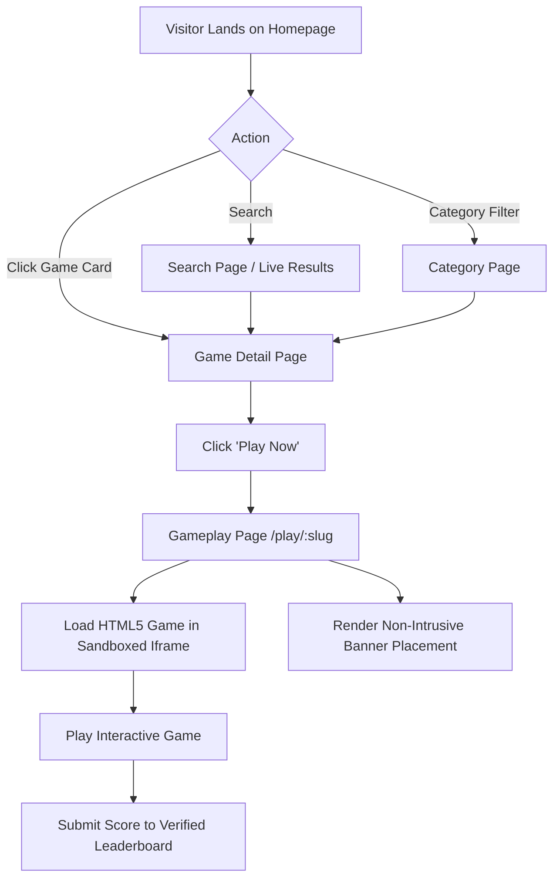
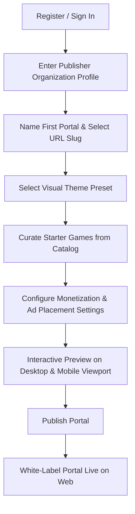
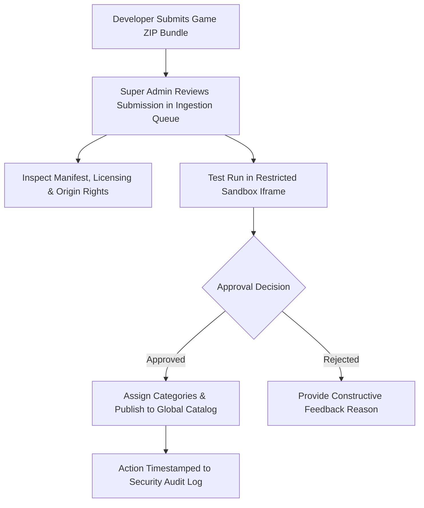
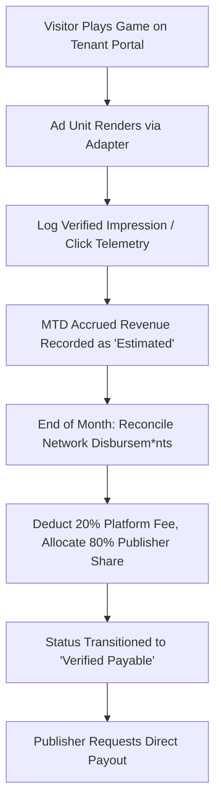

# USER FLOWS & WORKFLOW SPECIFICATION

## Flow 1: Player Instant Discovery & Gameplay

## Flow 2: Publisher Onboarding to Live Portal

## Flow 3: Super Admin Game Upload & Ingestion

## Flow 4: Ad Monetization & Revenue Reconciliation

